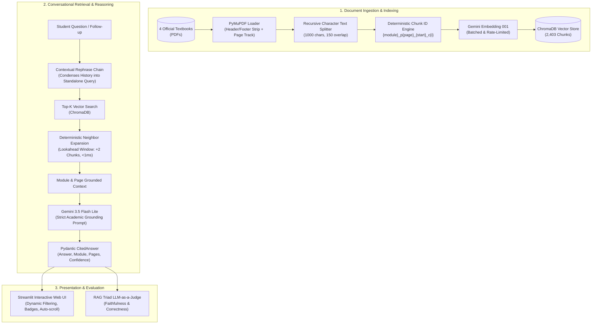

# 🎓 Ethiopian Freshman Modules RAG Tutor

[](https://www.python.org/downloads/)
[](https://python.langchain.com/)
[](https://ai.google.dev/)
[](https://www.trychroma.com/)
[](https://streamlit.io/)
[](https://github.com/astral-sh/uv)

A production-grade, conversational Retrieval-Augmented Generation (RAG) system engineered for Ethiopian university freshman students. It provides accurate, grounded answers with **exact page-level and module-level citations** across four standard national freshman textbooks.

---

## 📚 Curricula Covered

The system indexes **2,403 high-density text chunks** across the official Ministry of Science and Higher Education (MoSHE) freshman curriculum:
* **History of Ethiopia and the Horn** (632 chunks)
* **General Physics** (477 chunks)
* **Logic and Critical Thinking** (909 chunks)
* **Emerging Technologies** (385 chunks)

---

## 🏗️ System Architecture



---

## ⚡ Key Engineering Highlights

### 1. Deterministic Neighbor Expansion (Solving Page-Spills at Zero Cost)
* **The Problem**: Academic textbooks frequently present lists, formulas, and proofs that span across chunk boundaries and page borders. Standard semantic search often retrieves the introductory chunk but misses the subsequent items on the following page (e.g., metaphysical subsets split across pages 21 and 22).
* **Our Solution**: Each chunk is tagged with an indexed coordinate: `{module}_p{page}_{start_index}_c{i}`. When candidate chunks are retrieved, `expand_with_neighbors()` instantly fetches the adjacent forward chunks (`c{i+1}`, `c{i+2}`) from local Chroma storage.
* **Impact**: Recovers complete multi-page concepts with **0 additional embedding API calls** and **< 1ms local lookup latency**, boosting answer correctness from **75.0% to 91.7%**.

### 2. Structured Pydantic Grounding (`CitedAnswer`)
Responses are strictly constrained via Gemini structured outputs to enforce academic integrity:
```python
class CitedAnswer(BaseModel):
    answer: str = Field(description="Direct grounded answer based strictly on context.")
    module: str = Field(description="Textbook name (e.g. 'History', 'Physics').")
    page_numbers: list[int] = Field(description="Exact page numbers containing evidence.")
    confidence: str = Field(description="'high', 'medium', or 'low'.")
```
If an out-of-syllabus query is asked, the model triggers strict negative guardrails and explicitly refuses to hallucinate.

### 3. Multi-Turn Conversational Memory
Integrates an LCEL `rephrase_chain` that converts conversational follow-ups (e.g., *"When did he die?"* or *"What are its applications?"*) into fully qualified standalone queries prior to semantic retrieval.

---

## 📊 Empirical Evaluation & Benchmark (RAG Triad)

We benchmarked the system using an automated **LLM-as-a-Judge** evaluation harness across a golden dataset of **29 test cases** (comprising 24 academic test cases across all 4 modules and 5 out-of-syllabus negative guardrail probes).

| Metric | Baseline ($k=3$, single chunk) | With Neighbor Expansion ($k=5$, +2 steps) | Benchmark Goal |
| :--- | :---: | :---: | :---: |
| **Retrieval Recall** | 100.0% | **100.0%** (24/24) | > 90% |
| **Citation Accuracy** | 100.0% | **100.0%** (24/24) | > 90% |
| **Faithfulness (Grounded)** | 95.8% | **100.0%** (24/24) | > 95% |
| **Answer Correctness** | 75.0% | **91.7%** (22/24) | > 85% |
| **Negative Guardrail Refusal**| 100.0% | **100.0%** (5/5) | 100% |

> **Key Takeaway**: Neighbor expansion successfully eliminated multi-page cutoff failures across dense lists in Logic and Emerging Technologies without introducing noise or hallucinations.

---

## 📂 Project Structure

```text
freshman-modules-rag/
├── data/
│   ├── raw/                 # Official textbook PDFs (History, Physics, Logic, Tech)
│   ├── eval_dataset.json    # 29 curated golden test cases (Q&A + Guardrails)
│   └── eval_results.json    # Automated LLM-as-a-Judge benchmark telemetry
├── src/
│   ├── __init__.py
│   ├── load.py              # PyMuPDF parser with header stripping & page tracking
│   ├── chunk.py             # Recursive character chunker with coordinate offsets
│   ├── index.py             # Idempotent batch-indexing pipeline into ChromaDB
│   ├── rag.py               # Core LCEL chains, CitedAnswer schema, & neighbor expansion
│   └── evaluate.py          # Dual LLM-as-a-judge evaluation suite (RAG Triad)
├── app.py                   # Full-featured Streamlit conversational web interface
├── pyproject.toml           # Modern Python packaging managed via uv
└── README.md
```

---

## 🚀 Quickstart Guide

### 1. Prerequisites
* Python 3.12+
* [uv package manager](https://github.com/astral-sh/uv) (recommended for ultra-fast dependency management)
* Google Gemini API Key

### 2. Installation
```powershell
# Clone the repository
git clone https://github.com/Bekafi01/freshman-modules-rag.git
cd freshman-modules-rag

# Install dependencies using uv
uv sync
```

### 3. Environment Setup
Create a `.env` file in the root directory:
```env
GEMINI_API_KEY="your-google-gemini-api-key"
```

### 4. Index the Textbooks
Place your textbook PDFs into `data/raw/` and populate the vector store:
```powershell
uv run python -m src.index
```

### 5. Launch the Streamlit Web Application
```powershell
uv run streamlit run app.py
```

### 6. Run the CLI Interactive Tutor
```powershell
uv run python -m src.rag
```

### 7. Run the Automated Evaluation Benchmark
```powershell
uv run python -m src.evaluate
```

---

## 🎯 Roadmap & Future Enhancements
- [ ] **Sub-Query Decomposition**: Automated multi-query execution for compound questions spanning disparate chapters (e.g. Blockchain vs. Autonomic Computing).
- [ ] **Hybrid Search**: Integrating BM25 keyword matching alongside dense vector embeddings.
- [ ] **Containerization**: Single-command deployment via Docker & Docker Compose.